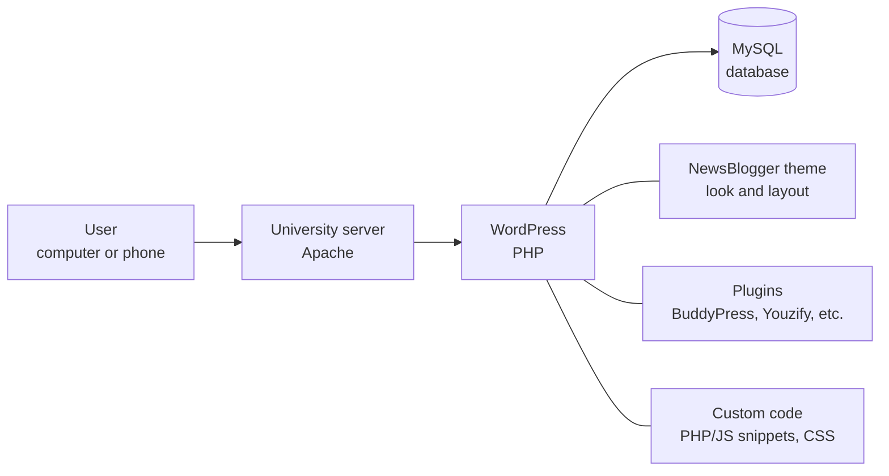

# Alumni Platform – ECE, University of Western Macedonia


A community website where graduates of the Department of Electrical and Computer Engineering at the University of Western Macedonia stay connected with each other and with the department.

**Live website:** [alumni.ece.uowm.gr](https://alumni.ece.uowm.gr) · Diploma thesis, grade **10/10**

## The problem it solves

Graduates had no central place to find former classmates, events and job opportunities. Most Greek alumni websites only publish announcements. This platform works like a small social network: members chat, share job openings and follow the department's news.

## Key features

- **Gathers** announcements, events and job openings on the home page.
- **Offers** a personal profile with graduation year, current position, skills, LinkedIn and GitHub.
- **Lists** all members with search, plus topic-based groups for discussion.
- **Lets** every graduate post job openings they have found.
- **Supports** private messages (chat) and an activity wall with posts and comments.
- **Shows** events as a list or calendar, with an "Add to Calendar" option.
- **Informs** members about master's programmes (MSc) and through a newsletter.
- **Adapts** to mobile phones, with dark mode, translation and accessibility tools.

## User roles

| Role | What they can do |
|---|---|
| **Visitor** | Browses the public pages (home, events, MSc, jobs) and signs up with email or a Google account. |
| **Graduate (member)** | Creates a profile, joins groups, sends messages, posts on the activity wall, publishes and deletes their own job posts, exports or deletes their data. |
| **Administrator** | Organizes content, oversees members and sets security and privacy rules. |

## Technologies

> *Plugin* = an add-on that gives WordPress a new feature. *Theme* = the visual design of the site.

| Layer | What was used |
|---|---|
| **Frontend** (what the user sees) | NewsBlogger theme (a variant of NewsCrunch), custom CSS and JavaScript, responsive design |
| **Backend** (the logic on the server) | WordPress (PHP), BuddyPress (social network), Youzify (profiles), Better Messages (chat), The Events Calendar (events), Submitted Posts (job board), custom PHP snippets via WPCode Lite |
| **Database** | MySQL |
| **Other** | Wordfence (security), caching plugin (speed), UpdraftPlus (backups), Complianz (cookies/GDPR), Nextend Social Login (Google sign-in), GTranslate (translation), UserWay (accessibility), Dracula Dark Mode, Noptin (newsletter), WP Mail SMTP (email delivery) |

## Architecture in brief

The website runs on a university server. WordPress is the core: it receives user requests, reads and writes data in the MySQL database and builds the pages. The look comes from the theme, and each feature (profiles, chat, events, etc.) comes from a separate plugin. All development was done through the WordPress admin dashboard, because the server and database are managed by the university's IT department.



## How to view it

1. Open the live website: **[alumni.ece.uowm.gr](https://alumni.ece.uowm.gr)**.
2. Click **Register** to try the member features (profile, groups, messages).

This repository **does not contain source code** and cannot be run locally. The website is hosted and maintained on the university's infrastructure, which I no longer have access to. This repository only documents the project. No credentials, personal data or university backups are included.

## Folder structure

```
├── README.md    # This project description
└── assets/      # Screenshots of the website and the speed tests
```

## Screenshots

| Events | Job board |
|---|---|
|  |  |

**Speed tests:** the page loads in 1.92 seconds (SiteSpeed.gr) and scored 70% on DebugBear.

| DebugBear | SiteSpeed.gr |
|---|---|
|  |  |

> Member and activity pages are not shown, to avoid publishing other people's personal data.

## Thesis details

- **Author:** Georgios Georgiadis
- **Degree:** Diploma in Informatics and Telecommunications Engineering
- **Supervisor:** Pantelis Angelidis, Professor
- **Institution:** University of Western Macedonia, Faculty of Engineering, Department of Electrical and Computer Engineering, Kozani, Greece
- **Year:** 2025 (October) · Grade 10/10
