# Alumni Platform – ECE, University of Western Macedonia

A small social network for the graduates of the Department of Electrical and Computer Engineering: profiles, groups, chat, events and a job board in one place.

**Live:** [alumni.ece.uowm.gr](https://alumni.ece.uowm.gr) · Diploma thesis, grade **10/10**

## Key features

- **Profiles** with graduation year, current job, skills, LinkedIn and GitHub
- **Member directory** with search, plus topic-based groups
- **Private chat** and an activity wall with posts and comments
- **Job board** where every graduate can post openings
- **Events** as a list or calendar, with "Add to Calendar"
- **Mobile-ready**, with dark mode, translation and accessibility tools

| Home page | Job board |
|---|---|
| 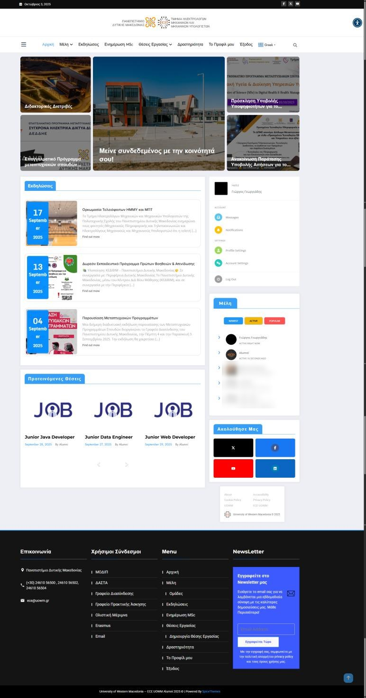 | 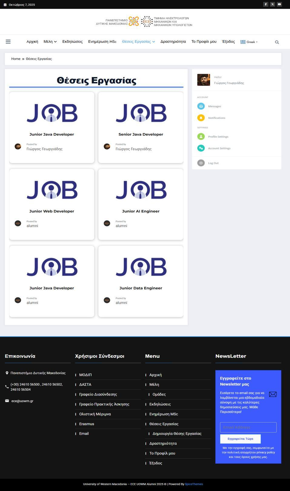 |

<b>More screenshots</b> (click to open)

 

| Events | Members |
|---|---|
| 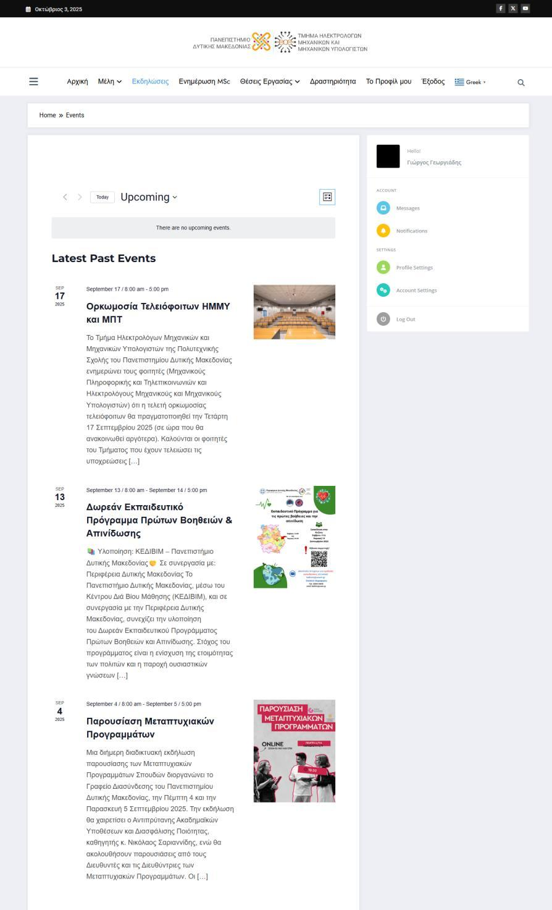 | 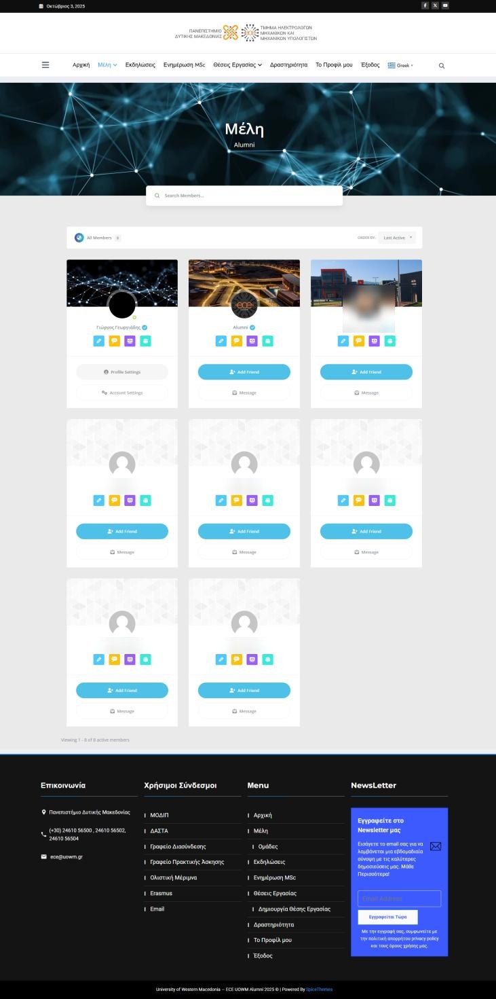 |

| Groups | Activity wall |
|---|---|
| 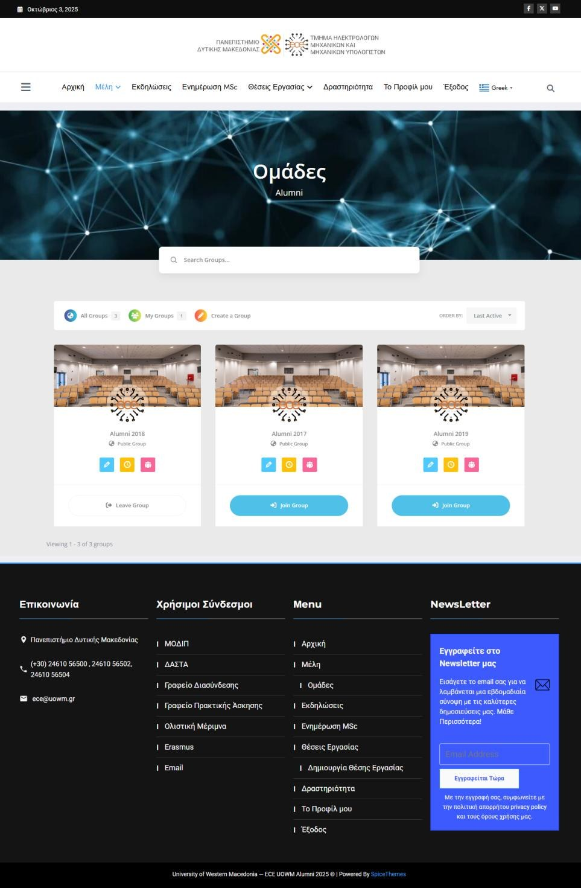 | 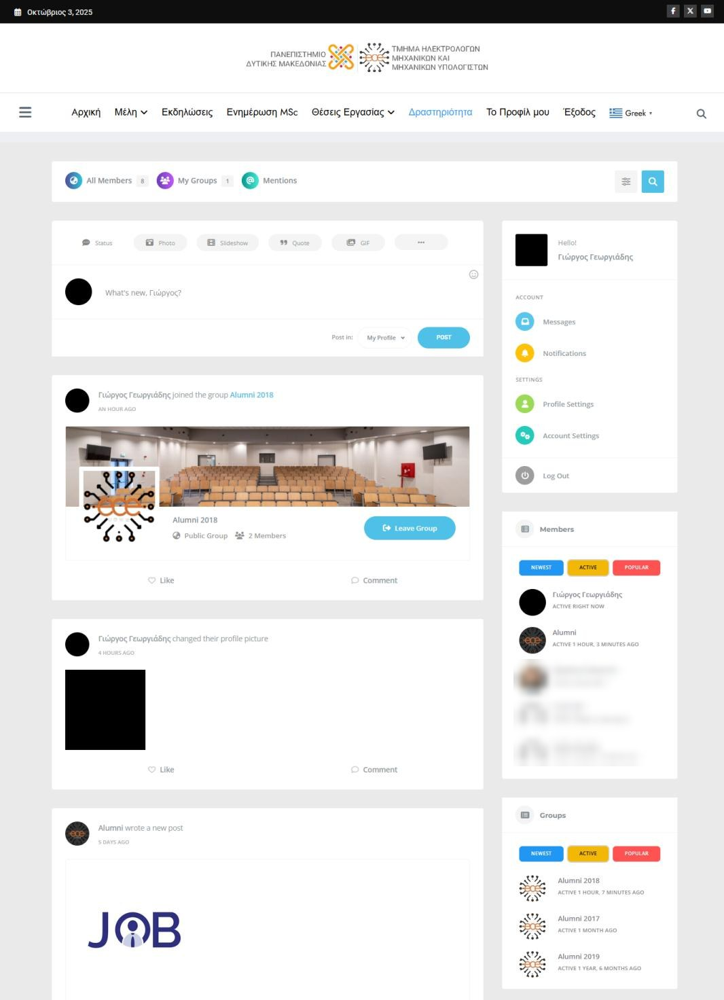 |

| Profile | Dark mode |
|---|---|
| 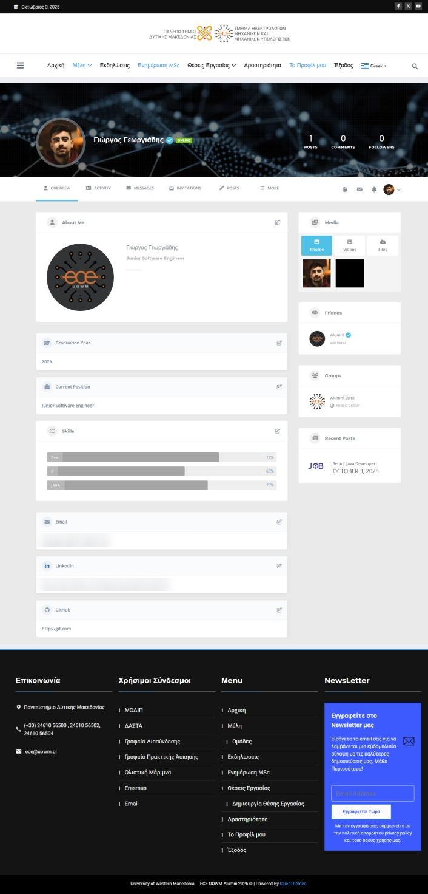 | 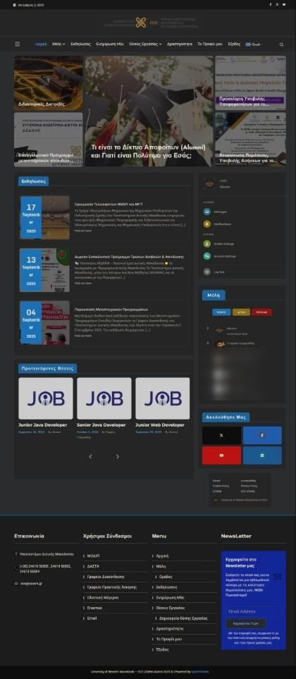 |

| MSc news | Post a job |
|---|---|
| 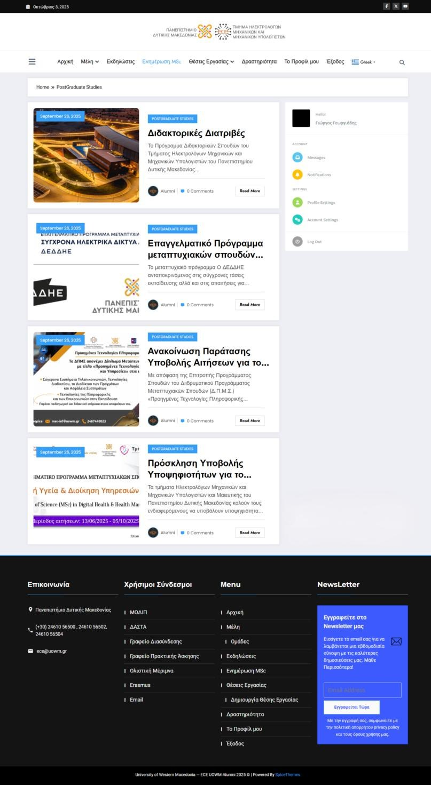 | 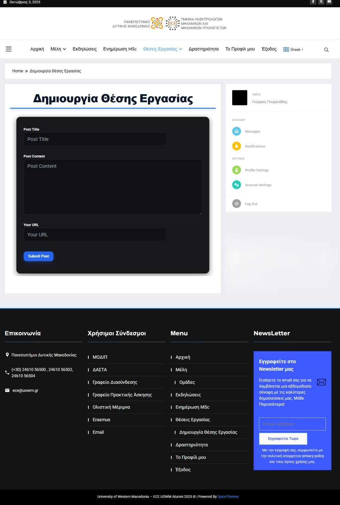 |

Names and photos of other members are blurred to protect their privacy.

## User roles

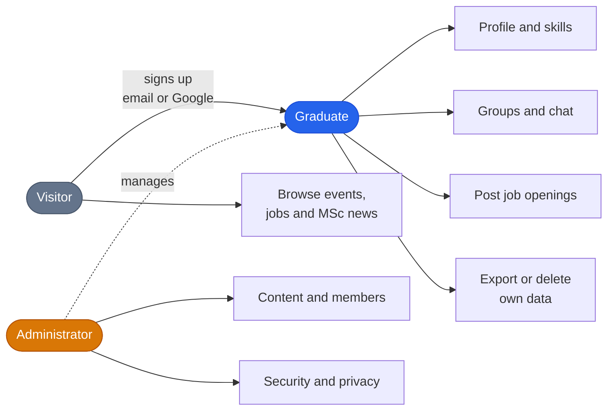

## Technologies

WordPress is the core. Each feature (profiles, chat, events, jobs) is a plugin, extended with custom PHP, JavaScript and CSS.

| Layer | Tools |
|---|---|
| **Frontend** |     |
| **Backend** |         |
| **Database** |  |
| **Security & privacy** |    |
| **Extras** |       |

## Performance

The live site loads in **1.92 s** (SiteSpeed.gr) and scores **70%** on DebugBear.

| DebugBear | SiteSpeed.gr |
|---|---|
| 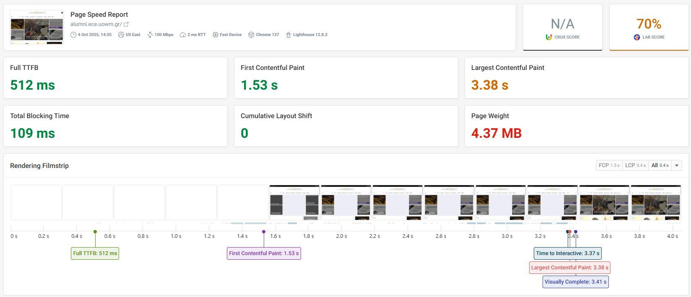 | 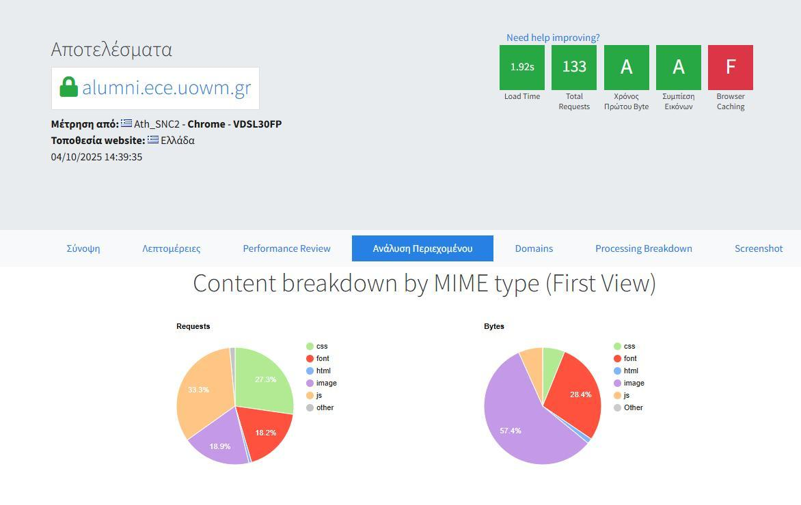 |

## About this repository

This repository documents the project and **does not contain source code**. The website runs on the university's servers, which I no longer have access to. No credentials, personal data or backups are included, and member pages are not shown to protect other people's data.

## Thesis details

**Georgios Georgiadis** · Diploma in Informatics and Telecommunications Engineering 
University of Western Macedonia, Department of Electrical and Computer Engineering · Supervisor: Prof. Pantelis Angelidis · October 2025 · Grade 10/10
