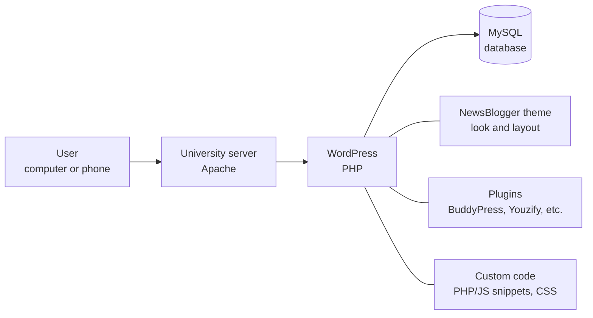
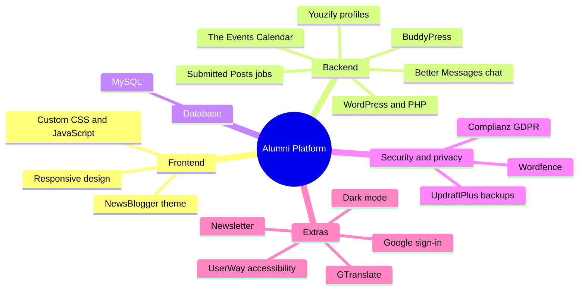

# Alumni Platform – ECE, University of Western Macedonia

A small social network for the graduates of the Department of Electrical and Computer Engineering: profiles, groups, chat, events and a job board in one place.

**Live:** [alumni.ece.uowm.gr](https://alumni.ece.uowm.gr) · Diploma thesis, grade **10/10**

| Events | Job board |
|---|---|
|  |  |

## How it works

WordPress is the core. Each feature (profiles, chat, events, jobs) is a plugin, extended with custom PHP, JavaScript and CSS.

## Key features

- **Profiles** with graduation year, current job, skills, LinkedIn and GitHub
- **Member directory** with search, plus topic-based groups
- **Private chat** and an activity wall with posts and comments
- **Job board** where every graduate can post openings
- **Events** as a list or calendar, with "Add to Calendar"
- **Mobile-ready**, with dark mode, translation and accessibility tools

## User roles

## Technologies

<b>Performance</b>: loads in 1.92 s, DebugBear score 70% (click to expand)

 

| DebugBear | SiteSpeed.gr |
|---|---|
|  |  |

## About this repository

This repository documents the project and **does not contain source code**. The website runs on the university's servers, which I no longer have access to. No credentials, personal data or backups are included, and member pages are not shown to protect other people's data.

## Thesis details

**Georgios Georgiadis** · Diploma in Informatics and Telecommunications Engineering 
University of Western Macedonia, Department of Electrical and Computer Engineering · Supervisor: Prof. Pantelis Angelidis · October 2025 · Grade 10/10
